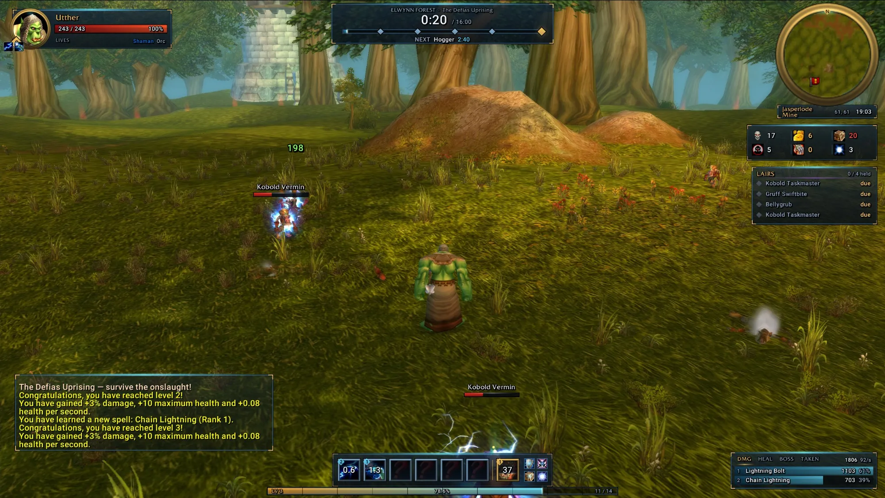
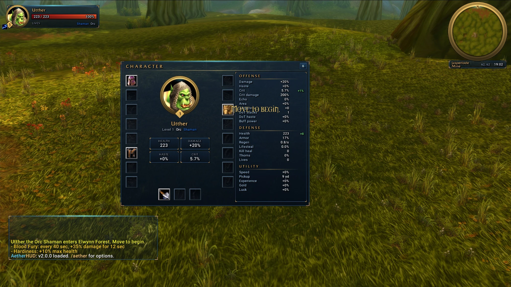
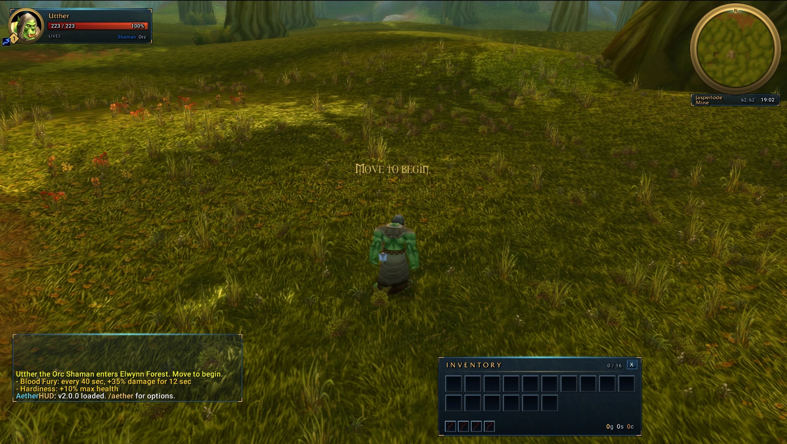

# AetherHUD

An Aion-style interface addon for **Azeroth Survivors**. It replaces the whole UI: the run
HUD, your unit frames, bags, character window, chat, minimap, tooltips, menus and the
pop-up text, all in navy glass panels with gold trim and aether-blue glow.



| Character window | Inventory |
|---|---|
|  |  |

## Download

Get `AetherHUD.zip` from the [latest release](../../releases/latest).

* **Windows / Linux:** unzip into `benilla-config/AddOns/` next to `AzerothSurvivors.exe`,
  so you end up with `benilla-config/AddOns/AetherHUD/AetherHUD.toc`.
* **Browser:** Options → AddOns → install the zip.

Turn off any other full UI (PhantomUI, SurvivorsDragonUi) in the AddOns list. AetherHUD
tells you in chat if one is still on.

## What's in it

* **Run clock** with a boss timeline and the next boss's countdown
* **Boss bars** with an enrage glow and debuff timers (click a bar to target the boss)
* **Enemy health plates** and **floating combat numbers** (crits in gold, spell-school colours)
* **Hero, target, party and pet frames**
* **Skill bar** with cooldowns, rank gems and talent/jewelry timers
* **Inventory** and a **character window** with every run stat and what your gear adds
* **Winged banners, loot cards, system messages** and a low-health glow
* **Combat meter** (damage, healing, boss, taken), run tally and lair tracker
* Glass **chat**, a ring **minimap**, and glass **tooltips and menus**

Every part can be switched off on its own. The game's own HUD parts, and any client
setting AetherHUD changes, come back when you log out, so removing the addon leaves the
game as it was.

The full feature list and notes are in [AetherHUD/README.md](AetherHUD/README.md).

## Commands

| Command | Does |
|---|---|
| `/aether` | Options: every part on or off, HUD size, number size, meter rows |
| `/aether unlock` / `lock` | Drag frames, resize with the mouse wheel, right-click to reset one |
| `/aether demo` | Fill every frame with a sample run, to preview and arrange outside a run |
| `/aether scale 0.9` | Overall size |
| `/aether reset` | Default layout |

## Development

The addon is plain Lua 5.0 for the WoW 1.12 client (`AetherHUD/`). The `tools/` folder
holds what was used to build and check it:

* `make_media.py` generates the textures in `AetherHUD/media/` (pure Python).
* `test_harness.py` runs the addon in a mock 1.12 client and checks it against a scripted
  run (176 checks) plus a lint for Lua 5.1+ syntax the game would reject. It reads the
  game's own addon-API code out of your copy of the game, so it needs the path to it:

  ```
  pip install lupa
  python tools/test_harness.py "path/to/AzerothSurvivors.exe"
  ```

* `render_preview.py` draws the addon's layout to an HTML page from the same mock client.

## License

MIT, see [LICENSE](LICENSE). The bundled Roboto font is © Google under the Apache
License 2.0 (`AetherHUD/media/Roboto-LICENSE.txt`).
